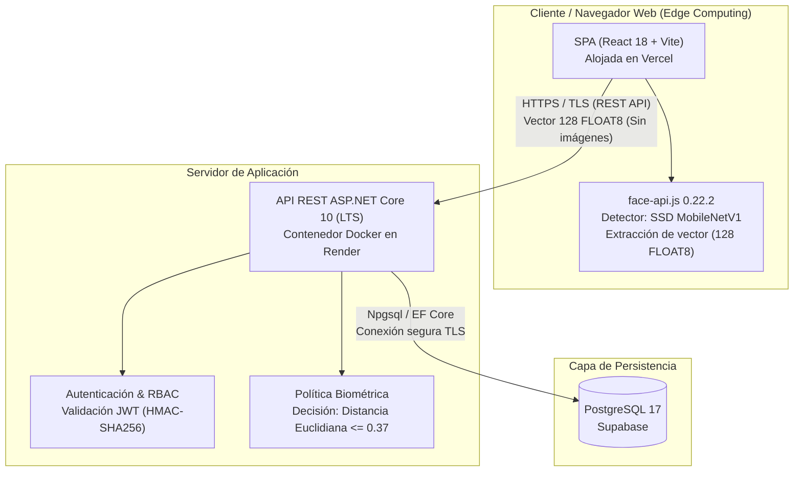

# Manual Técnico del Sistema de Control de Accesos de Bicicletas (UCSM)

El presente documento constituye el manual técnico y de arquitectura para el Sistema de Control de Accesos de Bicicletas de la Universidad Católica de Santa María (UCSM). Describe la arquitectura general, los procedimientos de despliegue y puesta en marcha local, el esquema de base de datos, los flujos de integración continua, las directivas de seguridad aplicadas, las optimizaciones de rendimiento y la resolución de incidentes frecuentes.

---

## 1. Arquitectura del Sistema

El sistema implementa una arquitectura desacoplada basada en la nube y cómputo en el extremo (*Edge Computing*), dividida en tres capas principales:



### 1.1. Componentes Principales
* **Frontend (SPA):** Desarrollado con React 18 y Vite. Se distribuye globalmente a través de la red de entrega de contenidos (CDN) de **Vercel**, proveyendo renderizado del lado del cliente y alta disponibilidad para las interfaces de garita, gestión y autoservicio.
* **Backend (API REST):** Desarrollado con **ASP.NET Core 10 (LTS)** y empaquetado en un contenedor Docker desplegado sobre la plataforma **Render**. Gestiona la lógica del negocio, políticas de autorización, trazabilidad de eventos y transacciones de base de datos.
* **Base de Datos:** Motor relacional **PostgreSQL 17** gestionado sobre **Supabase**, utilizando tipos primitivos nativos para vectores biométricos, restricciones de integridad referencial, vistas de auditoría y procedimientos almacenados bajo transaccionalidad estricta (ACID).

### 1.2. Biometría y Cómputo en el Extremo (*Edge Computing*)
El sistema aplica el principio de minimización de datos exigido por la **Ley N.º 29733 (Ley de Protección de Datos Personales de la República del Perú)**:
* **Cómputo en el navegador:** La detección de rostros y la extracción del descriptor biométrico se ejecutan localmente en el navegador del operador o del usuario mediante la librería `face-api.js` (versión 0.22.2) y el modelo de detección `SSD MobileNetV1` (confianza mínima > 0.90).
* **Descriptor de 128 dimensiones:** La captura biométrica genera únicamente un vector numérico de 128 valores de coma flotante (`FLOAT8[128]`).
* **Decisión en el servidor:** El navegador transmite exclusivamente el vector numérico hacia la API mediante HTTPS. El servidor calcula la distancia euclidiana frente al descriptor de referencia previamente enrolado y valida si cumple con el umbral calibrado $\theta = 0.37$.
* **No almacenamiento de imágenes:** Bajo ningún concepto se transmiten, procesan ni almacenan fotografías, fotogramas o imágenes de los rostros en el servidor ni en la base de datos. Los vectores transitorios de verificación se descartan de memoria tras la comparación; la única excepción es el modo de investigación de la Fase B (sección 3.1, `V006`), que conserva descriptores seudonimizados de participantes con consentimiento hasta concluir el estudio.

### 1.3. Control de Acceso Basado en Roles (RBAC)
El sistema define cuatro roles jerárquicos identificados de manera numérica y vinculados al *claim* `id_rol` en el token JWT:

| ID Rol | Nombre | Ámbito y Responsabilidades |
|:---:|:---|:---|
| **1** | **Estudiante** | Consulta de historial personal de accesos (`/estudiante/historial`) y registro/enrolamiento de bicicleta (`/estudiante/registro`). |
| **2** | **Garitero** | Operación operativa exclusiva en caseta de control: verificación biométrica y registro de ingresos/salidas (`/garita/control-acceso`). |
| **3** | **Supervisor** | Operación de garita, gestión y regularización de contingencias manuales (`/supervisor/contingencias`) y visualización del panel de monitoreo (`/gestion/monitoreo`). |
| **4** | **Administrador** | Control total del sistema: gestión y auditoría de usuarios (`/admin/usuarios`), monitoreo operativo en tiempo real, resolución de contingencias y control de accesos. |

---

## 2. Puesta en Marcha Local

### 2.1. Requisitos de Software
Para ejecutar la plataforma en un entorno de desarrollo local se requiere:
* **Node.js:** Versión 22 LTS (incluye `npm`).
* **.NET SDK:** Versión 10.0.x (requerido para compilar y ejecutar la solución `BicicletasUcsm.sln`).
* **Docker / Docker Desktop:** Para la ejecución de contenedores de base de datos PostgreSQL 17 o empaquetado de la API.
* **Cliente PostgreSQL (`psql`):** Versión 17 para la ejecución de scripts y validación de migraciones.

### 2.2. Comandos de Compilación y Pruebas

#### Frontend (SPA React)
Desde el directorio `frontend/`:
```bash
# Instalación de dependencias (modo limpio)
npm ci

# Ejecución en modo desarrollo con recarga en caliente
npm run dev

# Ejecución de pruebas unitarias y de accesibilidad con Vitest
npm test

# Ejecución de pruebas en modo CI con reporte de cobertura
npm run test:ci

# Compilación para producción (empaquetado en dist/)
npm run build
```

#### Backend (API ASP.NET Core 10)
Desde el directorio `backend/`:
```bash
# Restauración de dependencias NuGet
dotnet restore BicicletasUcsm.sln

# Compilación de la solución en modo Release
dotnet build BicicletasUcsm.sln -c Release

# Ejecución de pruebas unitarias y de integración xUnit con cobertura
dotnet test BicicletasUcsm.sln -c Release --collect:"XPlat Code Coverage"

# Ejecución local de la API
dotnet run --project src/Bicicletas.Api/Bicicletas.Api.csproj
```

### 2.3. Variables de Entorno
Por razones estrictas de seguridad, **nunca se versionan valores reales, contraseñas, secretos criptográficos ni URLs de conexión** en el repositorio. A continuación se listan los nombres de las variables de entorno reconocidas por los componentes del sistema:

#### Frontend (`frontend/.env` / Vercel)
* `VITE_API_URL`: URL base del servicio de API REST (ejemplo conceptual: `https://<host-api>/api/v1`).

#### Backend (`backend/` / Render / Docker)
* `PORT`: Puerto TCP en el que el servidor Kestrel escuchará peticiones HTTP (asignado automáticamente por Render).
* `ConnectionStrings__Principal`: Cadena de conexión para la base de datos principal PostgreSQL 17 (formato compatible con Npgsql).
* `Jwt__ClaveFirma`: Clave simétrica de firma HMAC-SHA256 para emisión y validación de tokens JWT (longitud mínima obligatoria: 32 caracteres).
* `Jwt__Emisor`: Cadena que identifica el emisor reconocido de los tokens JWT (`ValidIssuer`).
* `Jwt__MinutosVigencia`: Duración en minutos de la vigencia del token (por defecto: 30 minutos).
* `Cors__OrigenPermitido`: Lista de orígenes web autorizados para interactuar con la API mediante CORS, separados por comas.
* `Biometria__UmbralTheta`: Valor numérico del umbral de decisión euclidiana $\theta$ (por defecto: `0.37`).
  > [!WARNING]
  > No debe modificarse: el valor 0.37 fue calibrado con el Dataset Primario Local UCSM (Fase A) para el detector SSD MobileNetV1 y el modelo face-api.js 0.22.2. Alterar el umbral, el detector o el modelo invalida la calibración.
* `Investigacion__FaseBHabilitada`: Booleano (`true`/`false`) que habilita el registro de telemetría experimental para la Fase B de investigación.

#### Entornos de Automatización y Pruebas (CI / E2E / Carga)
* `ConnectionStrings__Pruebas`: Cadena de conexión empleada por la factoría de pruebas de integración xUnit contra el contenedor efímero.
* `SONAR_TOKEN`: Token de autenticación para publicación de análisis en SonarCloud.
* `SONAR_ORGANIZATION`: Clave de la organización en SonarCloud.
* `RENDER_DEPLOY_HOOK_URL`: URL de webhook para disparar el despliegue del backend en Render.
* `VERCEL_DEPLOY_HOOK_URL`: URL de webhook para disparar el despliegue del frontend en Vercel.
* `E2E_BASE_URL`: URL base de la aplicación para las pruebas de extremo a extremo con Playwright.
* `E2E_PERMITIR_ESCRITURA`: Bandera para autorizar escrituras en las pruebas E2E.
* `E2E_ESTUDIANTE_EMAIL`, `E2E_ESTUDIANTE_PASSWORD`: Credenciales de prueba para el rol Estudiante.
* `E2E_GARITERO_EMAIL`, `E2E_GARITERO_PASSWORD`: Credenciales de prueba para el rol Garitero.
* `E2E_SUPERVISOR_EMAIL`, `E2E_SUPERVISOR_PASSWORD`: Credenciales de prueba para el rol Supervisor.
* `E2E_ADMIN_EMAIL`, `E2E_ADMIN_PASSWORD`: Credenciales de prueba para el rol Administrador.
* `E2E_BICICLETA_QR`: Identificador de bicicleta de prueba para flujo E2E.
* `K6_BASE_URL`: URL base de la API REST para las pruebas de carga con k6.
* `K6_CORREO`, `K6_PASSWORD`, `K6_CODIGO_QR`: Credenciales y parámetros para las pruebas de carga.
* `K6_PERMITIR_ESCRITURA`: Bandera que habilita pruebas con mutación de datos en k6.
* `ZAP_URL_SPA`, `ZAP_URL_API`: URLs objetivo opcionales para los escaneos de seguridad con OWASP ZAP.
* `SUPABASE_DB_URL`: Cadena de conexión para la ejecución del respaldo diario en Supabase.
* `BACKUP_PASSPHRASE`: Frase de paso para el cifrado simétrico AES-256 de los respaldos lógicos.

---

## 3. Base de Datos y Migraciones

El esquema relacional del sistema reside en `database/migrations/`. Los archivos de migración son inmutables una vez incorporados a la rama principal (`main`).

### 3.1. Orden Secuencial de Migraciones

| Archivo | Descripción y Objeto de Base de Datos |
|:---|:---|
| `V001__esquema_base.sql` | Crea las tablas estructurales: `usuarios`, `estudiantes`, `bicicletas`, `descriptores_biometricos`, `ingresos_bicicletas`, `auditoria_accesos` y `contingencias_ingreso`. Establece identificadores UUID (`gen_random_uuid()`), tipo `FLOAT8[128]` para descriptores faciales, restricciones de integridad referencial y de dominio (CHECK, UNIQUE), e índices B-Tree. |
| `V002__auditoria_solo_insercion.sql` | Implementa una función disparadora (*trigger*) sobre la tabla `auditoria_accesos` que rechaza operaciones `UPDATE` o `DELETE`, garantizando la inmutabilidad y no repudio del registro de accesos. |
| `V003__cc08_cc10_conciliacion.sql` | Define procedimientos almacenados transaccionales ACID (`conciliar_contingencia`, `conciliar_lote`), la vista analítica `v_monitoreo_auditoria` y revoca privilegios innecesarios a roles no administrativos. |
| `V004__seguridad_rls.sql` | Activa la Seguridad a Nivel de Fila (*Row Level Security* - RLS) en todas las tablas sin habilitar políticas permisivas para roles anónimos (`anon`) ni autenticados (`authenticated`), mitigando el riesgo OWASP A01 y restringiendo el acceso exclusivamente a la API. |
| `V005__catalogo_roles.sql` | Inicializa el catálogo maestro de roles RBAC (1: Estudiante, 2: Garitero, 3: Supervisor, 4: Administrador). |
| `V006__investigacion_fase_b.sql` | Crea la tabla `investigacion_capturas` para registrar, durante la experimentación de la Fase B, descriptores seudonimizados (`FLOAT8[128]`), distancias euclidianas y latencias, solo de participantes con consentimiento informado. Opera únicamente si se activa el modo de investigación (`Investigacion__FaseBHabilitada`) y debe vaciarse al concluir el estudio. |

### 3.2. Ejecución de Migraciones

#### Aplicación en Integración Continua (CI)
En el flujo de GitHub Actions (`ci.yml`), las migraciones se aplican automáticamente desde cero sobre una instancia efímera de PostgreSQL 17 ejecutando en orden alfanumérico estricto:
```bash
for f in $(ls database/migrations/*.sql | sort); do
  psql -v ON_ERROR_STOP=1 -f "$f"
done
```

#### Aplicación Manual en Supabase
Para reflejar cambios en la base de datos de producción o puesta en escena en Supabase:
1. **Vía Consola Web (SQL Editor):** Abrir el Editor SQL en el panel de Supabase y ejecutar el contenido del archivo de migración correspondiente respetando estrictamente el orden correlativo (`V001` a `V006`).
2. **Vía Línea de Comandos (`psql`):** Conectarse a la base de datos de Supabase empleando la cadena de conexión administrativa y ejecutar los archivos secuencialmente:
   ```bash
   psql "<CADENA_CONEXION_ADMINISTRATIVA>" -v ON_ERROR_STOP=1 -f database/migrations/V001__esquema_base.sql
   psql "<CADENA_CONEXION_ADMINISTRATIVA>" -v ON_ERROR_STOP=1 -f database/migrations/V002__auditoria_solo_insercion.sql
   # Proceder correlativamente hasta V006
   ```

---

## 4. Integración y Despliegue Continuo (CI/CD)

Las canalizaciones de automatización residen en `.github/workflows/` y garantizan calidad, seguridad y despliegue confiable.

### 4.1. Canalización Principal (`ci.yml`)
Se activa ante cualquier evento de `push` a cualquier rama, en solicitudes de extracción (`pull_request`) dirigidas a `main` y de manera manual (`workflow_dispatch`). Consta de cuatro fases organizadas en trabajos (*jobs*):
1. **`database` (Base de datos):** Despliega un servicio Docker con PostgreSQL 17, simula los roles de Supabase (`anon`, `authenticated`), aplica las migraciones `V001` a `V006` en orden estricto y ejecuta la suite de pruebas SQL de integridad ACID (`database/tests/*.sql`).
2. **`backend` (API ASP.NET Core 10):**
   * Configura .NET SDK 10 y Java 17.
   * Inicializa el escáner de **SonarCloud** (`dotnet-sonarscanner`).
   * **Exclusiones de SonarCloud:** Para enfocar el análisis de calidad estrictamente en el código fuente de la API, se configuran las exclusiones explícitas:
     `/d:sonar.exclusions="frontend/**,database/**,ia/**,e2e/**,tests/**"`
   * Compila la solución en configuración Release.
   * Ejecuta pruebas unitarias y de integración xUnit generando reportes en formato OpenCover y TRX.
   * Audita vulnerabilidades conocidas en dependencias NuGet (`dotnet list package --vulnerable`).
   * Verifica la correcta compilación de la imagen Docker de la API (`docker build`).
3. **`frontend` (SPA React):**
   * Configura Node.js versión 22.
   * Instala dependencias con `npm ci --ignore-scripts` para mitigar riesgos de cadena de suministro.
   * Ejecuta análisis de estilo y reglas con ESLint (`npm run lint`).
   * Corre pruebas unitarias, de integración y de accesibilidad con Vitest (`npm run test:ci`).
   * Audita dependencias npm contra vulnerabilidades (`npm audit --omit=dev --audit-level=high`).
   * Compila la aplicación con Vite (`npm run build`).
   * Realiza análisis estático en SonarCloud mediante la acción oficial `SonarSource/sonarqube-scan-action`.
4. **`desplegar` (Despliegue a Staging):** Se ejecuta únicamente al fusionar en `main` tras la aprobación exitosa de los tres trabajos previos. Solicita el despliegue a través de peticiones HTTP POST hacia los *Deploy Hooks* configurados en GitHub Secrets: `RENDER_DEPLOY_HOOK_URL` (para la API) y `VERCEL_DEPLOY_HOOK_URL` (para la SPA).

### 4.2. Flujo de Pruebas Extremo a Extremo (`e2e.yml`)
* **Propósito:** Ejecución automatizada de flujos completos de usuario en navegador Chromium con **Playwright**.
* **Disparador:** Manual mediante `workflow_dispatch`.
* **Control de escritura:** Cuenta con el parámetro de entrada `permitir_escritura`, cuyo valor por defecto es **`false`**.

> [!CAUTION]
> **ADVERTENCIA CRÍTICA:** No activar operaciones de escritura (`permitir_escritura = true`) contra el entorno piloto real. Esta opción está reservada exclusivamente para bases de datos de prueba desechables a fin de salvaguardar la integridad de los datos de operación.

### 4.3. Flujo de Pruebas de Carga (`carga.yml`)
* **Herramienta:** Ejecuta la herramienta de rendimiento **k6** a través del script `tests/carga/rnf01-carga.js`.
* **Parámetros del ensayo:** Simula una concurrencia de 10 usuarios virtuales (VUs) durante una ventana de 2 minutos.
* **Umbrales de Calidad (RNF-01):**
  * `http_req_duration{escenario:consulta}`: Percentil 95 menor a 2000 ms (`p(95) < 2000`).
  * `http_req_failed{escenario:consulta}`: Tasa de fallos menor al 1 % (`rate < 0.01`).
  * Al menos una solicitud ejecutada en el escenario (`http_reqs{escenario:consulta}`: `count > 0`), lo que impide aprobar el ensayo sin tráfico real.
* **Resultados:** Los reportes generados se consolidan en la carpeta `tests/carga/resultados/` y se almacenan como artefacto con retención de 14 días.

### 4.4. Escaneo de Seguridad OWASP ZAP (`seguridad-zap.yml`)
* **Herramienta:** Ejecuta **OWASP ZAP Baseline Scan** (`zaproxy/action-baseline`) mediante ejecución manual (`workflow_dispatch`).
* **Modalidad:** Escaneo pasivo no invasivo sin credenciales ni transacciones de escritura.
* **Objetivos:** Analiza tanto la SPA como la API. Admite la parametrización de objetivos mediante las variables/secretos opcionales `ZAP_URL_SPA` y `ZAP_URL_API` (con valores por defecto hacia las URLs desplegadas).
* **Gestión de reglas:** Utiliza el archivo `.zap/reglas.tsv` para clasificar reglas y justificar excepciones.
* **Artefactos y Documentación:** Publica reportes en formato HTML, JSON y Markdown (retención 14 días). El detalle de los hallazgos y su tratamiento se documentan en [ESCANEO_ZAP.md](seguridad/ESCANEO_ZAP.md).

### 4.5. Flujo de Respaldo Diario de Supabase (`backup-supabase.yml`)
* **Propósito:** Genera respaldos lógicos diarios automatizados de la base de datos de producción mediante `pg_dump` de PostgreSQL 17 (programado a las 03:00 UTC / 22:00 hora de Lima y disponible bajo demanda).
* **Cifrado de seguridad:** Dado que el repositorio de GitHub es público, el respaldo en texto plano nunca se expone; el archivo extraído se comprime con `gzip` y se cifra simétricamente con algoritmo **AES-256** mediante GPG empleando la clave secreta `BACKUP_PASSPHRASE`.
* **Cumplimiento legal:** Protege los datos personales de la comunidad universitaria en estricto cumplimiento de la Ley N.º 29733 antes de almacenar el artefacto resultante (retención de 30 días).

---

## 5. Cabeceras de Seguridad HTTP

El sistema implementa una arquitectura defensiva en profundidad mediante directivas de seguridad configuradas a nivel de borde (SPA) y servidor (API).

### 5.1. Cabeceras en la SPA (`frontend/vercel.json`)
Definidas en el enrutamiento perimetral para responder en todas las rutas de la aplicación:

* **`Content-Security-Policy` (CSP):**
  ```text
  default-src 'self'; script-src 'self'; style-src 'self'; img-src 'self' data: blob:; connect-src 'self' https://sistema-bicicletas.onrender.com; media-src 'self' blob: mediastream:; font-src 'self'; object-src 'none'; base-uri 'self'; form-action 'self'; frame-ancestors 'none'
  ```
  *Nota destacada:* La directiva `style-src 'self'` opera de forma restrictiva **sin** la opción `'unsafe-inline'`, eliminando la ejecución de estilos inyectados maliciosamente.
* **`X-Frame-Options`:** `DENY` (bloquea totalmente la incrustación en marcos o `iframe`, mitigando *Clickjacking*).
* **`X-Content-Type-Options`:** `nosniff` (previene la interpretación indebida del tipo MIME).
* **`Referrer-Policy`:** `strict-origin-when-cross-origin` (protege la fuga de rutas internas en solicitudes salientes).
* **`Permissions-Policy`:** `camera=(self), microphone=(), geolocation=(), payment=(), usb=()` (permite la cámara únicamente al propio origen de la aplicación y bloquea sensores no requeridos).
* **`Cross-Origin-Opener-Policy`:** `same-origin` (aísla el contexto de navegación frente a ventanas emergentes externas).
* **`Access-Control-Allow-Origin`:** `https://sistema-bicicletas.vercel.app` (restringe las respuestas autorizadas).

### 5.2. Middleware en la API (`backend/src/Bicicletas.Api/Program.cs`)
Inyectado de manera global en el cauce de procesamiento (*pipeline*) de ASP.NET Core mediante un middleware registrado antes de `UseExceptionHandler` (y, por tanto, antes de `UseCors`) que aplica las cabeceras con `Response.OnStarting`, garantizando su presencia en respuestas exitosas y de error:

* **`Strict-Transport-Security` (HSTS):** `max-age=31536000; includeSubDomains` (fuerza comunicación TLS estricta por un año continuo).
* **`X-Content-Type-Options`:** `nosniff` (impide *MIME-sniffing* en respuestas de la API).
* **`X-Frame-Options`:** `DENY` (bloquea la visualización de respuestas en contextos embebidos).
* **`Referrer-Policy`:** `no-referrer` (omite información del referente en peticiones subsiguientes).
* **`Cache-Control`:** `no-store` (prohíbe el almacenamiento de respuestas con datos de usuarios o tokens en cachés intermedias o locales).

---

## 6. Estrategias de Rendimiento y Optimización

Para garantizar una experiencia ágil y satisfacer el requerimiento RNF-01 (< 2 segundos por interacción), el sistema implementa tres optimizaciones clave:

### 6.1. Caché Inmutable para Modelos y Recursos Estáticos
En la configuración de `frontend/vercel.json`, se definen directivas de almacenamiento inmutable para activos que no cambian entre despliegues:
* Pesos de las redes neuronales de detección (`/models/*`):
  `Cache-Control: public, max-age=31536000, immutable`
* Paquetes de código y estilos con hash de Vite (`/assets/*`):
  `Cache-Control: public, max-age=31536000, immutable`
Esto elimina solicitudes redundantes de red en visitas consecutivas del navegador del operador.

### 6.2. Precarga y Calentamiento Biométrico
Implementado en el módulo `frontend/src/biometria/extractorFacial.js` a través de la función `prepararBiometria`:
* **Carga desacoplada:** Los modelos de `face-api.js` (`ssdMobilenetv1`, `faceLandmark68Net`, `faceRecognitionNet`) se cargan de forma asíncrona en memoria antes de la apertura del flujo de captura.
* **Calentamiento de GPU:** Se ejecuta una inferencia en blanco sobre un elemento `<canvas>` sintético en memoria. Esto fuerza a la tarjeta gráfica o acelerador de hardware a compilar los programas (*shaders*) de WebGL/TensorFlow.js con anticipación. Cuando el usuario se presenta frente a la cámara, el sistema ejecuta la inferencia directamente sin penalización por compilación inicial.

### 6.3. Preconexión y Mantenimiento de la API
* **Preconexión en el HTML:** En el archivo `frontend/index.html` se incluye la etiqueta:
  ```html
  <link rel="preconnect" href="https://sistema-bicicletas.onrender.com" crossorigin />
  ```
  Esto inicia de forma temprana la resolución DNS, el intercambio TCP y la negociación de certificados TLS con el servidor de la API antes de que se dispare la primera petición del usuario.
* **Mantenimiento en Caliente:** El servicio `frontend/src/services/precalentador.js` gestiona un latido periódico hacia el endpoint `/health` de la API para mantener el entorno de ejecución activo en los periodos de operación de la garita.

---

## 7. Solución de Problemas Frecuentes

### 7.1. Primera Petición Lenta por Arranque en Frío de Render
* **Síntoma:** Al abrir la aplicación tras un periodo prolongado de inactividad, la primera solicitud de autenticación o consulta puede demorar varias decenas de segundos.
* **Causa:** El contenedor de la API en Render suspende el proceso cuando no recibe tráfico para optimizar recursos en niveles de uso compartido o gratuitos (*cold start*).
* **Solución:**
  1. El cliente web cuenta con un mecanismo que despierta la API de fondo (`despertarApi`) desde la carga de la pantalla de bienvenida.
  2. Verificar que el endpoint `GET /health` responde con estado HTTP 200. Una vez activo el contenedor, el tiempo de respuesta retorna a sus valores habituales.

### 7.2. Fallo de Inicio de Sesión en Vistas Previas de Vercel por Bloqueo CORS
* **Síntoma:** Las ramas de vista previa generadas por Vercel (URLs dinámicas tipo `https://sistema-bicicletas-git-<rama>.vercel.app`) cargan la interfaz pero fallan al enviar credenciales, reportando error de red (*Network Error* / CORS) en la consola del navegador.
* **Causa:** La política de CORS en `backend/src/Bicicletas.Api/Program.cs` restringe estrictamente los dominios permitidos a aquellos enumerados en la variable de entorno `Cors__OrigenPermitido`. Por omisión, solo está registrado el dominio de producción (`https://sistema-bicicletas.vercel.app`).
* **Solución:** Si se requiere habilitar una vista previa específica para pruebas de validación, se debe agregar temporalmente el dominio de la vista previa a la variable de entorno `Cors__OrigenPermitido` en la configuración del servicio en Render, separándolo por coma del dominio principal (por ejemplo: `https://sistema-bicicletas.vercel.app,https://sistema-bicicletas-git-mi-rama.vercel.app`).

### 7.3. Error de Acceso a la Cámara en la Verificación Biométrica
* **Síntoma:** La interfaz de Garita o Enrolamiento muestra una alerta de error biométrico indicando que el dispositivo de video no se encuentra disponible o que el permiso ha sido denegado.
* **Causa:**
  1. **Contexto no seguro:** Las especificaciones de los navegadores modernos restringen la API `navigator.mediaDevices.getUserMedia` a contextos seguros exclusivamente (orígenes `https://` o `localhost`).
  2. **Política de permisos del navegador:** El usuario u operador rechazó o bloqueó el acceso a la cámara en el cuadro de diálogo del navegador.
  3. **Directiva Permissions-Policy:** La cabecera HTTP restringe la cámara exclusivamente al origen actual (`camera=(self)`).
* **Solución:**
  1. Asegurar que la aplicación esté siendo servida mediante el protocolo HTTPS.
  2. En la configuración de permisos del navegador para el sitio (ícono del candado en la barra de direcciones), verificar que el permiso de «Cámara» se encuentre establecido en «Permitir».
  3. Si otra aplicación del sistema operativo tiene el dispositivo de video capturado de forma exclusiva, cerrar la aplicación en conflicto y recargar la página.
